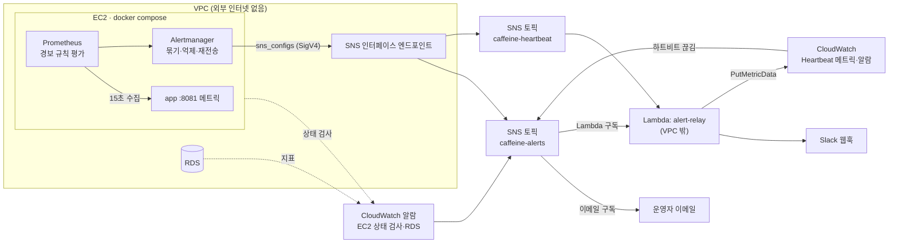

# 장애 경보 설계 — 외부 인터넷이 없는 EC2에서 운영자에게 알리기

> 작성: 2026-11-09 · 상태: **3단계 중 레포 작업 구현** (경보 규칙·promtool 테스트·Alertmanager 설정·로컬 compose·CI 검사, 2026-11-09).
> AWS 1·2·4단계는 **스크립트·절차 준비됨, 실행 전** (`ops/경보-AWS-설정.md`, `monitoring/aws/`, 2026-11-09).
> Lambda `caffeine-alert-relay`는 코드·테스트·배포 스크립트 구현, 배포 전.
> 대상: `monitoring/` 경보 규칙·Alertmanager 추가 + AWS SNS·Lambda·CloudWatch 알람
>
> 구현된 부분의 원본은 `monitoring/`·`docker-compose.*.yml`·`ops/운영-가이드.md` "경보" 절이다. 이 문서의 예시와 다르면 그쪽이 맞다.
> 이 문서 자체는 어떤 테스트도 대조하지 않는다.

---

## 1. 목적과 전제

지금은 장애를 **사람이 Grafana를 열어 봐야** 안다. `ops/운영-가이드.md`도 "EC2는 외부 인터넷이 없으므로 Alertmanager를 둬도
메일·Slack 경보를 보낼 수 없다 — 지금은 대시보드를 보는 데까지다"라고 적고 있다. 이 설계는 장애가 나면 **운영자의 이메일과
메신저(Slack)로 먼저 알려 주는 것**이 목표다.

### 1.1 전제: 외부 인터넷 차단은 유지한다

EC2의 외부 인터넷 차단을 풀지 않는다(2026-11-09 결정). NAT를 붙이면 Alertmanager가 Slack으로 직접 보낼 수 있지만,
서버가 침해됐을 때 데이터 유출·원격 조종 경로를 막는 이점을 포기하게 된다. 그래서 **AWS SNS까지만 VPC 엔드포인트로 열고,
인터넷으로 나가는 일은 VPC 밖 Lambda에 맡긴다.** `push-bridge-plan.md`와 같은 방식이다.

### 1.2 사용자 푸시와는 별개다

`CLAUDE.md` 도메인 계약의 "서버는 푸시를 보내지 않는다"는 **사용자 기기로 가는 알림**에 대한 것이다. 이 설계는 운영자 한 명에게
가는 장애 경보이고, 앱·API·DB 스키마를 바꾸지 않는다. Spring 코드도 바꾸지 않는다. 앱이 직접 경보를 보내면 앱이 죽을 때
경보도 같이 죽기 때문이다.

### 1.3 풀어야 할 문제 두 가지

1. **어떻게 VPC 밖으로 내보내나.** → SNS 인터페이스 엔드포인트 + VPC 밖 Lambda (§2)
2. **서버가 통째로 죽으면 누가 알리나.** EC2 안의 Prometheus는 EC2와 함께 멈춘다. → EC2 바깥의 CloudWatch가 지켜본다.
   EC2 상태 검사 알람과, 경보 경로 전체가 살아 있는지 확인하는 하트비트(dead man's switch)를 둔다 (§5)

---

## 2. 구조



### 2.1 동작 순서

1. Prometheus가 15초마다 앱 메트릭을 수집하고, `alerts.yml` 규칙을 평가해 조건을 만족하면 Alertmanager로 넘긴다.
2. Alertmanager가 같은 경보를 묶고, 원인 경보가 있으면 결과 경보를 억제한 뒤, SNS 엔드포인트를 거쳐 `caffeine-alerts`에 발행한다.
3. SNS가 이메일 구독자에게 바로 보내고, 같은 메시지로 Lambda `alert-relay`도 호출한다. Lambda는 Slack 웹훅으로 전달한다.
4. 늘 켜져 있는 `Watchdog` 경보가 5분마다 `caffeine-heartbeat`로 발행된다. Lambda가 이 신호를 받을 때마다 CloudWatch 메트릭을 1 올린다.
5. 하트비트가 15분 동안 오지 않거나 EC2·RDS 알람이 울리면, CloudWatch가 `caffeine-alerts`로 직접 발행한다. 이 경로는 EC2와 무관하다.

### 2.2 설계 결정

| 결정 | 이유 |
|---|---|
| 규칙은 **Prometheus 규칙 파일 + Alertmanager** | 규칙이 레포의 YAML로 남고 `promtool test rules`로 **단위 테스트**할 수 있다. 화면에서 고친 내용이 저장되지 않는 Grafana 대시보드와 같은 원칙이다 |
| 출구는 **SNS 하나** | Alertmanager가 `sns_configs`를 기본 지원하고, CloudWatch 알람도 SNS로 보낸다. 서버 안쪽 경보와 바깥쪽 경보가 같은 토픽·같은 채널로 모인다 |
| **이메일은 SNS 직접 구독** | Lambda·Slack이 고장 나도 이메일은 온다. 채널 하나는 우리 코드에 의존하지 않게 둔다 |
| Lambda는 **VPC 밖** | VPC 안에 두면 Slack으로 나가는 데 NAT가 필요하다. DB 접근도 필요 없다 |
| Lambda는 **전달만** | 문구는 Alertmanager 템플릿(레포)에서 만든다. 이메일과 Slack이 같은 문장을 받고, Lambda는 형식 변환과 길이 제한만 맡는다 |
| 인증은 **EC2 인스턴스 역할** | 키를 `.env`나 레포에 두지 않는다. Alertmanager의 SigV4가 AWS 기본 자격 증명 체인으로 인스턴스 역할을 읽는다 |
| 토픽은 **둘** (`alerts`·`heartbeat`) | 하트비트가 이메일로 가지 않게 하는 가장 단순한 방법이다. 구독 필터 정책보다 IAM과 동작이 명확하다 |
| Lambda는 **하나**(`alert-relay`) | 두 토픽을 같은 함수가 구독하고 `TopicArn`으로 분기한다. 수동 배포 단위가 하나로 준다 |
| 배포는 **수동** | CD 자동화 금지 결정을 따른다. Alertmanager 이미지는 Prometheus처럼 `docker load`로 옮기고, Lambda는 zip으로 올린다 |
| **도메인 정상성은 경보하지 않는다** | 사용자가 적어 "학습이 하루 동안 0건" 같은 조건은 오탐이 대부분이다. 도메인 메트릭은 대시보드로 본다 |

### 2.3 대안

| 대안 | 내용 | 판단 |
|---|---|---|
| B. Grafana Alerting | 이미 떠 있는 Grafana의 경보 기능과 SNS 연락처 사용 | **예비안.** 컨테이너가 하나 덜 든다. 다만 경보 상태가 `grafana-data` 볼륨에 살고 규칙 단위 테스트 도구가 없다 |
| C. CloudWatch 에이전트만 사용 | EC2에 에이전트를 깔아 앱 메트릭을 CloudWatch로 보내고 거기서 알람 | 제외. `monitoring`·`logs` 엔드포인트가 더 필요하고, 규칙이 콘솔에 있어 레포로 관리되지 않는다. EC2·RDS 수준 알람에만 CloudWatch를 쓴다 |
| D. 외부 업타임 서비스(Route 53 헬스체크 등) | 바깥에서 공개 주소로 주기적으로 접속 | **HTTPS 적용 후 추가.** "사용자 입장에서 접속되는가"를 보는 유일한 방법이지만 지금은 공개 HTTPS 주소가 없다 |
| E. SQS 엔드포인트 공유 | 푸시 브리지의 SQS 엔드포인트로 경보도 보냄 | 제외. Alertmanager는 SQS를 지원하지 않아 변환기 컨테이너를 따로 만들어야 한다. 비용 통합은 §10 미결 5 |
| F. NAT 추가 | Alertmanager → Slack 직접 | 제외. §1.1 결정 |

---

## 3. 경보 규칙

파일: `monitoring/prometheus/alerts.yml`. 모든 식에 `job="caffeine-app"`을 붙이고, HTTP 메트릭은 대시보드와 같게
`uri!~"/actuator.*"`로 Prometheus 수집 요청을 뺀다. **임계값은 초기값이다.** 시연 트래픽을 보고 조정하고, 바꿀 때 promtool 테스트도
같이 고친다.

| 경보 | 식 (요약) | `for` | 심각도 | 의미 |
|---|---|---|---|---|
| `AppDown` | `up == 0` | 2m | critical | Prometheus가 앱 메트릭을 못 긁는다. 컨테이너 종료·멈춤 |
| `AppRestarted` | `changes(process_start_time_seconds[10m]) > 0` | — | warning | 앱이 재시작됐다. 메모리 부족(OOM)·크래시. 배포 때는 사일런스로 끈다(§7.3) |
| `High5xxRate` | 5xx 비율 > 5% **그리고** 5분간 5xx ≥ 3건 | 2m | critical | 서버 오류가 잦다. 건수 조건은 요청 2건 중 1건 실패로 50%가 되는 저트래픽 오탐을 막는다 |
| `HighLatencyP95` | p95 > 1s (버킷 경계값이라 보간 오차가 없다) | 10m | warning | 응답이 느리다 |
| `DbConnectionPending` | `max(hikaricp_connections_pending) > 0` | 2m | critical | 커넥션 풀이 고갈됐다. RDS 장애·느린 쿼리 신호 |
| `DbConnectionTimeout` | `increase(hikaricp_connections_timeout_total[5m]) > 0` | — | critical | 커넥션을 30초 안에 못 받은 요청이 있다 |
| `HeapHigh` | 힙 사용 ÷ 힙 최대 > 0.9 | 10m | warning | 메모리 부족 직전. 최대값이 `-1`인 풀은 `> 0`으로 걸러 낸다 |
| `ErrorLogBurst` | `increase(logback_events_total{level="error"}[10m]) ≥ 5` | — | warning | ERROR 로그가 몰린다 |
| `DiskSpaceLow` | `disk_free_bytes / disk_total_bytes < 0.15` | 10m | warning | 디스크 부족. 배포 tar와 로그가 쌓이는 EC2라 필요하다 |
| `DiskSpaceCritical` | 같은 비율 `< 0.05` | 5m | critical | 곧 가득 찬다. 울리면 `DiskSpaceLow`는 억제한다 |
| `SuspiciousLogin` | 15분간 로그인 실패 ≥ 30 **또는** 로그인 429 ≥ 20 | — | warning | 비밀번호 대입·이메일 목록 대입 공격 의심. 이메일 하나당 15분 5회 제한이므로 30회는 여러 계정이 동시에 두드려진다는 뜻이다 |
| `Watchdog` | `vector(1)` | — | heartbeat | 늘 울린다. 경보 경로가 살아 있다는 신호(§5.2) |

```yaml
# 예시 두 개. 나머지도 같은 형식이다.
groups:
  - name: caffeine-app
    rules:
      - alert: High5xxRate
        expr: |
          (
            sum(rate(http_server_requests_seconds_count{job="caffeine-app",uri!~"/actuator.*",status=~"5.."}[5m]))
              / sum(rate(http_server_requests_seconds_count{job="caffeine-app",uri!~"/actuator.*"}[5m]))
          ) > 0.05
          and
          sum(increase(http_server_requests_seconds_count{job="caffeine-app",uri!~"/actuator.*",status=~"5.."}[5m])) >= 3
        for: 2m
        labels: { severity: critical }
        annotations:
          summary: "서버 오류(5xx) 급증"
          description: "최근 5분 5xx 비율 {{ $value | humanizePercentage }}"
          runbook: "운영 가이드 '메트릭과 로그' — docker logs --since 로 requestId 추적"
      - alert: Watchdog
        expr: vector(1)
        labels: { severity: heartbeat }
        annotations:
          summary: "경보 경로 하트비트"
```

- 경보 라벨과 문구에 **userId·이메일 같은 사용자별 값을 넣지 않는다.** 메트릭 태그 규칙(`CLAUDE.md`)과 같고, 그래서 SNS 메시지에 개인정보가 없다.
- `disk_free_bytes`·`disk_total_bytes`는 Spring Boot가 기본 등록하는 디스크 메트릭이다. 노출은 `AlertRuleMetricsIT`로 확인했다.
  컨테이너 안의 경로로 재므로 **값이 EC2 루트 디스크(`df -h /`)와 맞는지는 운영에서 확인한다.** 맞지 않으면 node-exporter를 추가한다(§10 미결 4).
- 규칙이 쓰는 메트릭·라벨 이름은 `AlertRuleMetricsIT`가 `/actuator/prometheus`와 대조한다. 경계값은 `alerts.test.yml`(promtool)이 검사한다.

---

## 4. Alertmanager

파일: `monitoring/alertmanager/alertmanager.yml`(운영)·`alertmanager.local.yml`(로컬, SNS 대신 수신기 컨테이너). 두 파일의 `route`·`inhibit_rules`는
같고 `monitoring/check.sh`가 대조한다. 컨테이너는 Prometheus처럼 루프백(`127.0.0.1:9093`)에만 열고 PC에서는 SSH 터널로 본다. 아래는 요약이다.

```yaml
route:
  receiver: alerts
  group_by: [alertname]
  group_wait: 30s
  group_interval: 5m
  repeat_interval: 4h            # 계속 울리는 warning 은 4시간마다만 다시 알린다
  routes:
    - matchers: [ 'alertname="Watchdog"' ]
      receiver: heartbeat
      group_wait: 0s
      group_interval: 1m
      repeat_interval: 5m        # 하트비트 주기
    - matchers: [ 'severity="critical"' ]
      receiver: alerts
      repeat_interval: 1h

inhibit_rules:
  # DB 문제면 그 결과인 5xx·에러 로그 경보는 보내지 않는다
  - source_matchers: [ 'alertname=~"DbConnectionPending|DbConnectionTimeout"' ]
    target_matchers: [ 'alertname=~"High5xxRate|ErrorLogBurst|HighLatencyP95"' ]
  # 디스크 critical 이면 warning 은 보내지 않는다
  - source_matchers: [ 'alertname="DiskSpaceCritical"' ]
    target_matchers: [ 'alertname="DiskSpaceLow"' ]

receivers:
  - name: alerts
    sns_configs:
      - topic_arn: __ALERT_TOPIC_ARN__
        sigv4: { region: __AWS_REGION__ }
        subject: '{{ template "caffeine.subject" . }}'
        message: '{{ template "caffeine.message" . }}'
        send_resolved: true
  - name: heartbeat
    sns_configs:
      - topic_arn: __HEARTBEAT_TOPIC_ARN__
        sigv4: { region: __AWS_REGION__ }
        message: 'heartbeat'
        send_resolved: false
```

### 4.1 메시지 형식

```text
제목: [CRITICAL] High5xxRate            ← SNS 제목은 ASCII만 허용된다(한글이면 발행 실패)
본문:
🔴 서버 오류(5xx) 급증
상태: 발생 · 시작 11-09 14:03
내용: 최근 5분 5xx 비율 12.5%
대응: 운영 가이드 '메트릭과 로그' — docker logs --since 로 requestId 추적
```

- 해결되면 `✅ [해결] 서버 오류(5xx) 급증 · 지속 18분`을 보낸다. 해결 알림이 없으면 운영자가 계속 들여다봐야 한다.
- 시각은 KST로 표기한다. 사용하는 Alertmanager 버전의 템플릿에 시간대 변환 함수가 없으면 UTC로 쓰고 `UTC`를 붙인다.
- 템플릿은 `monitoring/alertmanager/templates/caffeine.tmpl`에 둔다.

### 4.2 토픽 ARN 주입

Alertmanager 설정 파일은 환경변수를 펼치지 않는다. 토픽 ARN에는 계정 ID가 들어 있어 레포에 직접 쓰지 않는다(§10 미결 3).
레포에는 `__ALERT_TOPIC_ARN__` 같은 자리표시자를 두고, `monitoring/alertmanager/entrypoint.sh`가 `.env` 값으로 치환한 사본을
데이터 볼륨에 만들어 띄운다. 스크립트는 값의 형식(SNS 토픽 ARN, 리전 문자)을 먼저 검사하고, 틀리면 이유를 남기고 끝낸다.
운영 compose에서 Alertmanager는 `alerting` 프로필 뒤에 있어, AWS 준비 전 평소의 `up -d`로는 뜨지 않는다.

`:?`(필수 변수)를 쓰지 않는다. `GRAFANA_ADMIN_PASSWORD`가 없으면 compose가 앱까지 기동을 거부하는 함정(`ops/운영-가이드.md` "알려진 함정")을
반복하지 않기 위해서다. 값이 비면 Alertmanager 컨테이너만 실패하고, 그 사실은 하트비트 알람이 알린다.

---

## 5. EC2 바깥의 감시 (CloudWatch)

`monitoring/aws/1-topics-and-alarms.sh`로 만든다(콘솔도 가능). 설정값은 스크립트가 원본이고, 절차는 `ops/경보-AWS-설정.md`.

### 5.1 인프라 알람

| 알람 | 조건 | 동작 |
|---|---|---|
| `ec2-status-check` | `StatusCheckFailed` ≥ 1, 1분 주기 2회 연속 | `caffeine-alerts`. 선택: 시스템 상태 검사 실패 시 **인스턴스 복구** 동작도 연결 |
| `rds-free-storage` | `FreeStorageSpace` < 2 GiB, 5분 주기 3회 | `caffeine-alerts` |
| `rds-cpu` | `CPUUtilization` > 80%, 5분 주기 3회 | `caffeine-alerts` |
| `ec2-cpu-credit` (버스트형 인스턴스일 때만) | `CPUCreditBalance` < 20 | `caffeine-alerts` |
| `caffeine-alert-relay-errors` | Lambda `Errors` ≥ 1, 5분 | `caffeine-alerts`. Slack 전달이 깨진 것을 이메일로 알린다 |

EC2 상태 검사 지표는 1분 단위로 무료 제공된다. 인스턴스 안에 아무것도 설치하지 않는다.

### 5.2 하트비트 (dead man's switch)

| 항목 | 값 |
|---|---|
| 메트릭 | 네임스페이스 `Caffeine/Monitoring`, 이름 `Heartbeat`, Lambda가 신호마다 1을 기록 |
| 알람 | 합계 < 1, 5분 주기 **3회 연속**, **누락 데이터는 위반으로 처리** |
| 동작 | `caffeine-alerts` (제목 `[CRITICAL] HeartbeatMissing`) |

Prometheus·Alertmanager·SNS 엔드포인트·IAM·Lambda 중 **어느 하나라도** 끊기면 15분 안에 울린다. EC2 전체가 멈춘 경우도 잡는다.
그래서 이 경보 문구는 "서버 다운"이 아니라 **"경보 경로 점검 필요"**로 쓴다. 원인은 §8 표로 좁힌다.

---

## 6. Lambda `alert-relay`

함수 이름은 `caffeine-alert-relay`다. 구현했고(2026-11-09) 배포는 `monitoring/aws/4-alert-relay.sh`, 절차는 `ops/경보-AWS-설정.md` 4단계다.

| 항목 | 값 |
|---|---|
| 런타임 | **nodejs22.x**, arm64, 128MB, **외부 의존성 없음**. 내장 `fetch`로 Slack을 호출하고, AWS SDK v3는 런타임에 포함돼 파일 두 개만 zip으로 올린다(`push-bridge-plan.md`와 같다) |
| VPC | 없음 |
| 제한 시간 | 10초 |
| 트리거 | SNS 구독 2개 (`caffeine-alerts`, `caffeine-heartbeat`) |
| 재시도 | SNS → Lambda 비동기 호출의 기본 재시도(2회). 실패가 계속되면 `caffeine-alert-relay-errors` 알람 |
| 환경변수 | `HEARTBEAT_TOPIC_ARN`, `SLACK_WEBHOOK_PARAM`(SSM 파라미터 이름, `/caffeine/alert-relay/slack-webhook`), `METRIC_NAMESPACE` |
| 코드 위치 | `monitoring/lambda/alert-relay/relay.mjs`(로직, 의존성 주입) · `index.mjs`(실제 AWS 클라이언트 연결) · `relay.test.mjs`(`node:test`, `check.sh`·CI) |

### 6.1 처리

```text
레코드마다:
  TopicArn == HEARTBEAT_TOPIC_ARN  → PutMetricData(Heartbeat=1) 후 끝
  Message 가 JSON 이고 AlarmName 이 있음 → CloudWatch 알람 형식. 이름·새 상태·사유로 문장 구성
  그 외                              → Alertmanager가 만든 문장을 그대로 사용
  Slack 수신 웹훅 POST { text }      ← & < > 를 바꾼 뒤 4000자를 넘으면 자르고 "…(이메일에서 전체 확인)"을 붙인다
  2xx가 아니면 예외 → SNS가 재시도
```

- 웹훅 URL은 아는 사람이 누구나 글을 쓸 수 있으므로 비밀로 다룬다. **SSM SecureString**에 두고 실행 환경에 5분 캐시한다.
- 로그·오류 메시지에 웹훅 URL을 남기지 않는다. 값이 Slack 수신 웹훅 주소(`https://hooks.slack.com/services/…`)가 아니면 보내지 않는다.
- 바깥에서 온 글자의 `&`·`<`·`>`를 `&amp;`·`&lt;`·`&gt;`로 바꾼다. Slack은 `<!channel>`·`<@U123>`·`<주소|글자>`처럼 꺾쇠로
  멘션과 링크를 만들므로, 문구에 이런 글자가 섞여도 아무도 호출되지 않고 글자 그대로 보인다. 굵은 제목(`*…*`)만 Lambda가 붙인다.
- CloudWatch 알람 시각은 KST로 바꿔 쓴다. Alertmanager 문장은 템플릿이 이미 KST다.
- 텔레그램 등 다른 메신저는 같은 함수에 전송부만 추가하면 된다. 첫 구현은 Slack 하나다(§10 미결 6). 처음에는 Discord로
  만들었다가 Slack으로 바꿨다(2026-11-09) — 바뀐 곳은 주소 검사·요청 본문·길이 제한·제어 문자 처리뿐이었다.

---

## 7. 보안·네트워크·운영

### 7.1 IAM과 네트워크 (최소 권한)

| 대상 | 권한·설정 |
|---|---|
| EC2 인스턴스 역할 | 두 토픽 ARN에 `sns:Publish`만 |
| SNS 인터페이스 엔드포인트 | EC2가 있는 서브넷 하나, **프라이빗 DNS 켬**(기본 SNS 주소가 사설 IP로 풀린다). 엔드포인트 정책도 두 토픽의 `sns:Publish`로 제한 |
| 엔드포인트 보안 그룹 | 인바운드 443, 출발지는 EC2 보안 그룹만 |
| Lambda 역할 | `cloudwatch:PutMetricData`(네임스페이스 조건), 해당 파라미터 `ssm:GetParameter`, 로그 권한 |
| 토픽 암호화 | **하지 않는다.** CloudWatch 알람은 AWS 관리형 키(`aws/sns`)로 암호화된 토픽에 발행하지 못한다. 메시지에 개인정보가 없으므로(§3) 고객 관리형 키 비용을 들일 이유가 없다 |

### 7.2 컨테이너에서 인스턴스 역할 읽기

Alertmanager는 컨테이너 안에서 인스턴스 메타데이터(IMDS)로 자격 증명을 받는다. **IMDSv2에서는 응답 홉 제한이 1이면 브리지 네트워크의
컨테이너가 토큰을 받지 못한다.** 홉 제한을 2로 올려야 한다. 이 설계에서 가장 놓치기 쉬운 지점이라 §11 1단계에서 먼저 확인한다.

### 7.3 배포 중 사일런스

수동 배포는 앱을 내렸다 올리므로 `AppDown`·`AppRestarted`가 울린다. 배포 절차 첫 줄에 사일런스를 추가한다.

```bash
docker exec caffeine-alertmanager amtool silence add 'alertname=~"AppDown|AppRestarted"' \
  --duration=15m --comment="수동 배포" --alertmanager.url=http://localhost:9093
```

잊어도 warning 1건과 critical 1건이 오고 곧 해결 알림이 오므로 해롭지 않다.

### 7.4 알림 피로 관리

- critical은 1시간, warning은 4시간마다만 다시 알린다(§4).
- 같은 원인에서 나온 경보는 억제 규칙으로 하나만 보낸다.
- 한 주 동안 아무 조치도 하지 않은 경보는 임계값을 올리거나 지운다. **울려도 아무도 행동하지 않는 경보는 진짜 경보를 묻는다.**

---

## 8. 실패 시나리오

| 상황 | 오는 알림 | 비고 |
|---|---|---|
| 앱 컨테이너 종료·멈춤 | `AppDown` (2분+) | |
| 앱 OOM 후 자동 재시작 | `AppRestarted`, 직전에 `HeapHigh`가 왔을 수 있음 | |
| RDS 장애·느린 쿼리 | `DbConnectionPending`/`Timeout` | 5xx·에러 로그·지연 경보는 억제 |
| EC2 전체 멈춤 | `ec2-status-check` (약 2분), `HeartbeatMissing` (15분) | EC2 안의 경보는 당연히 안 온다 |
| Prometheus·Alertmanager 종료 | `HeartbeatMissing` | |
| SNS 엔드포인트·IAM·IMDS 문제 | `HeartbeatMissing` | Alertmanager 로그에 SNS 발행 오류 |
| Lambda·Slack 장애 | Slack은 안 오고 **이메일은 온다**: `caffeine-alert-relay-errors`, `caffeine-heartbeat-missing` | 이메일을 직접 구독으로 둔 이유 |
| 디스크 부족 | `DiskLow` warning → critical | 오래된 배포 tar를 지운다 |
| 로그인 공격 | `SuspiciousLogin` | 서버의 시도 제한(429)은 이미 동작 중. 경보는 사람이 알게 하는 용도 |
| 배포 | 사일런스로 없음 | 잊으면 경보 2건 후 해결 알림 |
| CloudWatch·SNS 자체 장애 | 없음 | AWS 리전 장애는 이 설계 범위 밖 |

---

## 9. 검증

| 단계 | 방법 | 필요한 것 |
|---|---|---|
| 규칙 단위 | `promtool test rules`로 각 경보의 경계값을 테스트한다. 예: 5xx 비율 5% 초과지만 2건이면 미발생, 3건이면 발생. `for` 직전·직후 | Prometheus 이미지만. AWS 불필요 |
| 설정 검사 | `promtool check rules`, `amtool check-config` | 같음 |
| 로컬 통합 | `docker-compose.monitoring.yml`에 Alertmanager를 추가한다. 앱을 내리면 `AppDown`이, 5xx를 유발하면 `High5xxRate`가 Alertmanager UI에 뜨는지 본다 | Docker |
| 경로 통합 | PC의 Alertmanager에서 **개발용 SNS 토픽**으로 발행 → 이메일·Slack 수신 확인. PC는 인터넷이 되므로 엔드포인트 없이 Lambda와 템플릿을 검증할 수 있다 | AWS 개발 토픽, 개발용 Slack 채널 |
| Lambda 단위 | 세 가지 입력(하트비트·CloudWatch 알람 JSON·Alertmanager 문장), 제어 문자 바꾸기, 4000자 자르기, Slack 오류 시 예외 | Node.js만 |
| 운영 종단 | EC2에서 하트비트가 CloudWatch에 쌓이는지 확인, `aws cloudwatch set-alarm-state`로 알람을 강제로 울려 이메일·Slack 수신 | 운영 계정 |

**수행 기록 (2026-11-09)**

- 규칙 단위·설정 검사: `monitoring/check.sh` 통과. CI `build-and-push` 잡이 빌드 전에 같은 스크립트를 돌린다(CD가 아니라 검사다).
  규칙 임계값·문구·라우팅·템플릿을 일부러 바꿔 보면 검사가 실패하는 것도 확인했다.
- 메트릭 이름: `AlertRuleMetricsIT` 통과. 메트릭·라벨 이름을 바꾸면 실패한다.
- 로컬 통합: Prometheus·Alertmanager 바이너리와 가짜 수집 대상으로 규칙 평가 → Alertmanager → 수신기 흐름을 확인했다.
  DB 타임아웃 경보가 ERROR 로그 경보를 억제하는 것, 배포 사일런스 명령, `entrypoint.sh`의 값 검사·치환도 확인했다.
  **`docker-compose.monitoring.yml`로 띄우는 확인은 Docker가 있는 PC에서 아직 하지 않았다.**
- Lambda 단위: `relay.test.mjs` 30개 통과(Node 22·20). 세 가지 입력, Slack 제어 문자 바꾸기, 4000자 자르기, 웹훅 캐시·형식 검사(Discord 주소 거부 포함), Slack 오류 시 예외.
  Alertmanager 입력은 템플릿 기대 렌더링 결과(`testdata/*.expected.txt`)를 그대로 쓴다. 로직을 일부러 바꾸면 테스트가 실패하는 것도 확인했다.
- Lambda 연결(`index.mjs`): 실제 AWS SDK v3로 moto(SSM·CloudWatch)에 붙여 돌렸다. SecureString 복호화, Heartbeat 메트릭 기록, Slack 요청 본문을 확인했다.
- 경로 통합·운영 종단: AWS 준비 뒤.

---

## 10. 미결 사항

**착수 전에 사용자가 확인해야 하는 것.** 운영 인프라는 접근 금지 대상이라 모두 확인하지 못했다.

1. **AWS 권한**: SNS 토픽·VPC 인터페이스 엔드포인트·인스턴스 역할·Lambda·CloudWatch 알람을 만들 수 있는가. 엔드포인트만 막히면
   §2.3 B·C도 같은 이유로 막히므로 이 과제는 HTTPS 적용 뒤 외부 업타임 감시(D)로 대체한다.
2. **IMDS 홉 제한과 리전**: EC2의 메타데이터 홉 제한(§7.2)과 리전. 인스턴스 역할이 이미 붙어 있는지도 확인한다.

**결정이 필요한 것.**

3. **토픽 ARN을 레포에 둘지**: AWS는 계정 ID를 비밀로 보지 않지만 공개 레포라면 노출을 줄이는 편이 낫다. 제안은 자리표시자 + `.env`(§4.2).
4. **디스크 감시 방식**: Spring 디스크 메트릭이 노출되는 것은 확인했다(`AlertRuleMetricsIT`). 값이 EC2 루트 디스크와 같은지 운영에서
   확인한 뒤, 다르면 node-exporter 추가(컨테이너 하나 더, 이미지 `docker load`).
5. **푸시 브리지와 엔드포인트 비용**: 둘 다 만들면 SQS·SNS 엔드포인트 두 개다. 푸시 발행을 SNS → SQS 팬아웃으로 바꾸면 SNS 엔드포인트
   하나로 합칠 수 있다. 푸시 브리지 착수 때 판단한다.
6. ~~메신저~~ → **Slack으로 결정**(2026-11-09, 처음 정한 Discord에서 변경).
7. ~~promtool을 CI에 넣을지~~ → **넣었다**(2026-11-09). 규칙 문법 오류가 운영 Prometheus 기동 실패로 이어지기 때문이다.

**비용(추정, 착수 전 현재 요금표로 확인).** SNS 인터페이스 엔드포인트가 대부분이며 AZ 하나에 월 약 7~10달러다. SNS 이메일·Lambda·
CloudWatch 알람 10개 이내·`PutMetricData`는 이 규모면 프리 티어 안이고, 커스텀 메트릭 `Heartbeat` 하나가 월 0.3달러 수준이다.

---

## 11. 단계

| 단계 | 내용 | 완료 기준 |
|---|---|---|
| 0 | §10의 1·2 확인 | 진행 가능 여부 결정 |
| 1 | SNS 토픽 두 개 + 이메일 구독 + §5.1 인프라 알람 (`1-topics-and-alarms.sh`) | `set-alarm-state`로 울린 테스트 알람이 이메일로 온다. **코드 없이 EC2 전체 장애를 먼저 잡는다**. 스크립트 준비됨, 실행 전 |
| 2 | 엔드포인트 + EC2 역할 + 홉 제한 (`2-ec2-to-sns.sh`) → EC2에서 수동 발행 | EC2의 컨테이너(aws-cli 이미지를 `docker load`)에서 `sns publish`한 메시지가 이메일로 온다. **가장 위험한 네트워크·권한 경로를 코드 전에 검증한다**. 스크립트 준비됨, 실행 전 |
| 3 | 경보 규칙 + promtool 테스트 + Alertmanager (로컬 → 운영) | 로컬에서 §9 규칙·통합 검증 통과, 운영에서 앱을 잠깐 내리면 `AppDown`과 해결 알림이 이메일로 온다. **레포 작업은 2026-11-09 구현, 운영 반영은 2단계 뒤** |
| 4 | Lambda `caffeine-alert-relay` + Slack + 하트비트 알람 + Lambda 오류 알람 (`4-alert-relay.sh`) | Slack 수신, Alertmanager를 15분 내리면 `HeartbeatMissing`이 온다. 코드·스크립트 준비됨, 배포 전 |
| 5 | 문서 동기화 (§12) | 운영 가이드에 절차·사일런스·알람 설정값 기록 |

---

## 12. 구현 시 같이 바꿀 것

| 문서·파일 | 변경 | 상태 |
|---|---|---|
| `ops/운영-가이드.md` | "경보" 절: 규칙 보는 법, Alertmanager 켜기, `.env`의 ARN 변수 3개, 배포 사일런스, 로컬 확인 | 2026-11-09 반영 |
| `ops/경보-AWS-설정.md` | 1·2단계 절차, 생기는 것, 확인·문제 해결, 콘솔 절차, 되돌리기 | 2026-11-09 반영 |
| `ops/운영-가이드.md` | 하트비트 알람이 울렸을 때 점검 순서(§8) | 2026-11-09 반영 |
| `ops/경보-AWS-설정.md` | 4단계(Slack 웹훅·SSM·배포·확인·문제 해결·되돌리기) | 2026-11-09 반영 |
| `CLAUDE.md` "바꾸면 같이 바꿀 것" | 메트릭 이름을 바꾸면 경보 규칙도 같이 바꾼다(`AlertRuleMetricsIT`가 대조), 경보 설정을 바꾸면 테스트·`check.sh` | 2026-11-09 반영 |
| `docker-compose.prod.yml`, `docker-compose.monitoring.yml` | Alertmanager 서비스(운영은 `alerting` 프로필). 이미지 태그는 두 파일과 `check.sh`가 같게 | 2026-11-09 반영 |
| `monitoring/prometheus/prometheus.yml` | `rule_files`, `alerting.alertmanagers` | 2026-11-09 반영 |
| `.env.example` | `ALERT_TOPIC_ARN`, `HEARTBEAT_TOPIC_ARN`, `AWS_REGION` | 2026-11-09 반영 |
| `.github/workflows/ci.yml` | 빌드 전 `monitoring/check.sh` | 2026-11-09 반영 |

API·DTO·DB 스키마·`features.md`는 바뀌지 않는다. 사용자에게 보이는 기능이 아니다.

---

## 13. 범위 밖

| 항목 | 이유 |
|---|---|
| NAT·외부 인터넷 개방 | §1.1 결정 |
| 사용자 기기 푸시 | `push-bridge-plan.md` |
| 로그 기반 경보(CloudWatch Logs 등) | 로그는 EC2의 json-file에 남는다. ERROR 건수는 `logback_events_total`로 대신한다 |
| 도메인 지표 이상 감지 | §2.2. 사용자 수가 적어 오탐이 대부분이다 |
| 당번 순번·전화 호출(PagerDuty 등) | 운영자가 한 명이다 |
| 자동 복구(재시작 스크립트 등) | EC2 인스턴스 복구 동작(§5.1, 선택) 외에는 두지 않는다. 컨테이너 재시작은 compose `restart: unless-stopped`가 이미 한다 |
| CD 자동화, 자동 스키마 적용 | `CLAUDE.md` 결정 사항 |

---

## 14. 관련 문서

- 서버 규칙: `../CLAUDE.md`, 문서 색인: `README.md`
- 현재 모니터링·배포 절차: `ops/운영-가이드.md` "메트릭과 로그"·"수동 배포 절차"·"알려진 함정"
- 같은 네트워크 우회 방식: `push-bridge-plan.md` §2
- 메트릭·대시보드: `../monitoring/`, `../src/main/resources/application-prod.yaml`
