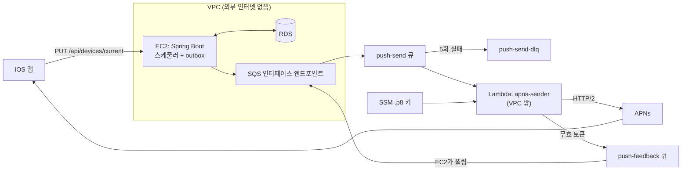

# 푸시 브리지 설계 — 외부 인터넷이 없는 EC2에서 APNs 푸시 보내기

> 작성: 2026-10-31 · 상태: **설계만** (코드·API 문서·DDL·AWS 리소스 미변경)
> 대상: 서버 `domain/push` 신설 + AWS SQS·Lambda + iOS 원격 알림 등록
>
> 착수할 때 이 문서의 API·DDL을 `api/api.md`·`api/openapi.yaml`·`db/db-schema.*`·`features.md`·`README.md`로 옮기고 구현과 함께 머지한다(`CLAUDE.md` "바꾸면 같이 바꿀 것").
> 이 문서는 그 전까지의 설계 메모이며, `ApiDocsConsistencyIT`가 대조하지 않는다.

---

## 1. 목적과 채택 근거

운영 EC2는 외부 인터넷에 나갈 수 없어 APNs에 직접 연결하지 못한다(`CLAUDE.md` 도메인 계약). 이 설계는 EC2의 네트워크 제약을 유지한 채, 외부로 나가는 일만 VPC 밖 Lambda에 맡긴다.

### 1.1 제품상 필수는 아니다

**이 과제는 제품 필수 기능이 아니라 아키텍처 도전 과제로 채택한다.** 서버의 사용자 데이터는 전부 앱에서 올라오므로, 앱을 열지 않는 동안 서버에 새 데이터가 생기지 않는다. 그래서 기능 대부분은 로컬 알림으로도 만들 수 있다.

| 하고 싶은 일 | 푸시 없이 되는가 |
|---|---|
| 기록 리마인더를 앱을 안 연 날에도 울리기 | **된다.** 알림 계획에 다음 날 이후 항목을 미리 내려주면 된다. 기록은 앱에서만 생기고 그때 재조회하므로 `cafeNearbyWindows`의 다음 날 구간과 같은 논리다 |
| 백그라운드 수면 업로드 후 학습 결과 알리기 | **된다.** 앱이 깨어 있는 상태이므로 `run` 응답으로 로컬 알림을 띄울 수 있다 |
| 주간 요약 | **대부분 된다.** 마지막 실행 때 미리 계산한 문구를 예약할 수 있다 |

푸시가 실제로 나은 경우는 다음과 같다.

- 앱 실행 없이 문구나 계산 변경을 반영할 수 있다.
- 한 기기에서 기록한 내용을 다른 기기의 알림에도 반영할 수 있다.
- 오랫동안 앱을 열지 않아 예약이 없는 사용자에게도 도달한다.
- iOS의 대기 알림 수 제한(앱당 64개)에 묶이지 않는다.

### 1.2 첫 사용 사례: 주간 요약

**기존 알림 세 종류는 옮기지 않는다.** 로컬 알림으로 잘 동작하고, 옮기면 푸시 장애가 곧 알림 장애가 된다. 새 종류 `WEEKLY_SUMMARY` 하나로 시작한다.

- 내용: `insight-plan.md` §2.6의 섭취 통계 문장. 예: "최근 7일 하루 평균 210mg, 400mg을 넘긴 날은 1일이에요."
- 발송: 사용자 로컬 시각 일요일 20:00
- 기본값: **꺼짐**(옵트인)
- **수면·HealthKit 유래 수치는 푸시 본문에 넣지 않는다.** 본문은 Apple 서버를 거치고 잠금 화면에도 보이기 때문이다. 카페인 기록 값만 쓴다.

---

## 2. 구조



### 2.1 동작 순서

1. 앱이 APNs 토큰을 받아 `PUT /api/devices/current`로 등록한다. 타임존과 APNs 환경도 함께 보낸다.
2. Spring `@Scheduled`가 5분마다 발송 대상을 찾아 `push_outbox`에 넣는다. `dedupe_key` UNIQUE로 중복을 막는다.
3. 발행기가 `PENDING` 행을 기기별 메시지로 펼쳐 SQS에 보내고 `PUBLISHED`로 바꾼다.
4. Lambda가 APNs로 전송한다. 일시 오류는 해당 메시지만 재시도한다.
5. 무효 토큰은 피드백 큐로 보내고, EC2가 폴링해 `device_tokens`에서 지운다.

### 2.2 설계 결정

| 결정 | 이유 |
|---|---|
| Lambda는 **VPC 밖** | VPC 안에 두면 APNs로 나가기 위해 NAT가 필요하다. DB 접근이 필요 없으므로 VPC에 넣을 이유도 없다 |
| **DB 접근은 Spring만** | Lambda가 RDS에 붙지 않으므로 커넥션 관리와 RDS 경로 개방 문제가 없다. 토큰 삭제도 피드백 큐를 거쳐 서버가 한다 |
| 스케줄러는 **Spring `@Scheduled`** | 이미 사용 중이고(`SchedulingConfig`) 인스턴스가 하나다. EventBridge는 사설망의 EC2를 깨우는 경로가 또 필요하다 |
| **Outbox** 사용 | SQS 발행이 실패하거나 서버가 재시작돼도 행이 남아 재발행된다. 발행은 `@Transactional` 밖에서 한다 |
| **표준 큐 + `apns-collapse-id`** | 표준 큐는 같은 메시지가 두 번 올 수 있다. `dedupe_key`를 collapse id로 쓰면 기기에서 하나로 합쳐지므로 FIFO 큐나 DynamoDB 중복 테이블이 필요 없다 |
| Lambda는 **Node.js 현행 LTS, 외부 의존성 없음** | 내장 `http2`·`crypto`로 APNs와 ES256 JWT를 처리하고 AWS SDK는 런타임에 포함되어, 파일 하나만 zip으로 수동 배포하면 된다. 팀 주력 언어가 아닌 점은 감수한다 |
| 배포는 **수동** | CD 자동화 금지 결정을 따른다. 절차는 구현 시 `ops/운영-가이드.md`에 적는다 |
| `PUSH_ENABLED` 기본 **false** | 끄면 아무 AWS 호출도 하지 않는다. 로컬·테스트 부팅에 새 환경변수가 필요 없고, 장애 시 이 값만 바꿔 되돌릴 수 있다 |

### 2.3 대안

| 대안 | 내용 | 판단 |
|---|---|---|
| **B. Lambda가 EC2에서 가져오기** | EventBridge가 Lambda를 깨우고, Lambda가 EC2 내부 API로 outbox를 받아 APNs로 보낸 뒤 결과를 돌려준다 | **예비안.** EC2 AWS 권한과 엔드포인트 비용이 필요 없다. 다만 기기 토큰과 본문이 공개 경로로 오가므로 **HTTPS 적용이 전제**다. 현재 HTTPS는 미완료다 |
| C. NAT 게이트웨이 추가 | EC2가 APNs로 직접 연결 | 제외. 외부 인터넷 차단 제약을 없애는 것이고 비용도 가장 크다 |
| D. 알림 계획 확장(로컬) | 다음 날 이후 항목을 미리 내려줌 | 푸시와 별개로 유효하다. §1.1의 기록 리마인더 공백은 이 방법이 더 싸다 |

---

## 3. 데이터 모델

`db-schema.sql` 규칙(H2 호환, `IF NOT EXISTS`, 수동 적용)을 따른다. 앱이 `ddl-auto: validate`로 대조하므로 **이미지 배포 전에 먼저 적용**한다.

```sql
-- device_tokens: APNs 기기 토큰 (전송에 원문이 필요해 해시하지 않는다)
CREATE TABLE IF NOT EXISTS device_tokens (
    id           BIGINT       NOT NULL AUTO_INCREMENT,
    user_id      BIGINT       NOT NULL,
    token        VARCHAR(200) NOT NULL,  -- APNs 기기 토큰
    environment  VARCHAR(16)  NOT NULL,  -- 'SANDBOX' | 'PRODUCTION'
    time_zone    VARCHAR(64)  NOT NULL,  -- IANA 타임존. 앱이 등록할 때마다 갱신
    last_seen_at DATETIME(6)  NOT NULL,
    created_at   DATETIME(6)  NOT NULL,
    updated_at   DATETIME(6)  NOT NULL,
    PRIMARY KEY (id),
    UNIQUE KEY uk_device_tokens_token (token),  -- 같은 기기에 다른 계정이 로그인하면 소유자를 옮긴다
    KEY idx_device_tokens_user_id (user_id),
    CONSTRAINT fk_device_tokens_user_id
        FOREIGN KEY (user_id) REFERENCES users (id) ON DELETE CASCADE
) ENGINE=InnoDB DEFAULT CHARSET=utf8mb4 COLLATE=utf8mb4_unicode_ci;

-- push_outbox: 발송할 푸시 (사용자·회차당 1건)
CREATE TABLE IF NOT EXISTS push_outbox (
    id           BIGINT       NOT NULL AUTO_INCREMENT,
    user_id      BIGINT       NOT NULL,
    dedupe_key   VARCHAR(64)  NOT NULL,  -- 예: WS:2026-W44:123. apns-collapse-id 로도 쓴다(64바이트 제한)
    type         VARCHAR(32)  NOT NULL,  -- 'WEEKLY_SUMMARY'
    title        VARCHAR(100) NOT NULL,
    body         VARCHAR(500) NOT NULL,
    status       VARCHAR(16)  NOT NULL,  -- 'PENDING' | 'PUBLISHED' | 'EXPIRED'
    expires_at   DATETIME(6)  NOT NULL,  -- 지나면 보내지 않는다
    published_at DATETIME(6)  NULL,
    created_at   DATETIME(6)  NOT NULL,
    updated_at   DATETIME(6)  NOT NULL,
    PRIMARY KEY (id),
    UNIQUE KEY uk_push_outbox_dedupe (dedupe_key),
    KEY idx_push_outbox_status_created (status, created_at),
    CONSTRAINT fk_push_outbox_user_id
        FOREIGN KEY (user_id) REFERENCES users (id) ON DELETE CASCADE
) ENGINE=InnoDB DEFAULT CHARSET=utf8mb4 COLLATE=utf8mb4_unicode_ci;

-- 기존 테이블 변경 (db-schema.md 변경 이력에 기록)
ALTER TABLE user_settings
    ADD COLUMN notify_weekly_summary BIT(1) NOT NULL DEFAULT 0;
```

- 타임존은 `user_settings`가 아니라 **기기 행**에 둔다. 앱이 이미 요청마다 `tz`를 보내고 있어 기기 값이 가장 최신이다. 기기가 여럿이면 `last_seen_at`이 가장 최근인 기기의 타임존을 쓴다.
- `DELIVERED` 상태는 두지 않는다. APNs 200은 수락일 뿐 기기 도달이 아니므로, 저장해도 의미 있는 값이 아니다.
- 발행 완료 후 30일이 지난 outbox 행은 `purgeStale`과 같은 방식의 `@Scheduled`로 지운다.

---

## 4. API 초안

| 메서드 | 경로 | 인증 | 기능 이름(`features.md`용) |
|---|---|---|---|
| PUT | `/api/devices/current` | Bearer | 푸시 기기 등록 |

```java
public record DeviceRegisterRequest(
        @NotBlank @Size(max = 200) String token,
        @NotNull ApnsEnvironment environment,   // SANDBOX | PRODUCTION
        @NotNull ZoneId timeZone
) {}
```

- 토큰 기준 upsert이고 멱등이다. 응답은 `ApiResponse.ok()`이다. 다른 사용자 소유 토큰이면 현재 사용자로 옮긴다.
- 앱은 실행할 때마다 호출한다. APNs 토큰은 바뀔 수 있다.
- **해제 엔드포인트는 두지 않는다.** `POST /api/auth/logout`은 이미 전 기기 로그아웃이므로(`AuthService.logout`), 여기서 해당 사용자의 기기 토큰도 함께 지운다.
- 설정: `notifications.weeklySummary`를 추가한다. **요청에서 생략 가능하게 둔다.** 2026-09-06에 `notifications` 필드를 필수로 추가해 구버전 앱의 설정 저장이 400이 된 전례가 있어 반복하지 않는다. 생략 시 기존 값을 유지한다.
- 기존 `GET /api/notifications/plan`은 바꾸지 않는다.

### 4.1 SQS 메시지 (`push-send`)

```json
{
  "v": 1,
  "dedupeKey": "WS:2026-W44:123",
  "token": "<APNs 기기 토큰>",
  "environment": "PRODUCTION",
  "title": "이번 주 카페인 요약",
  "body": "최근 7일 하루 평균 210mg, 400mg을 넘긴 날은 1일이에요.",
  "expiresAt": "2026-11-01T13:00:00Z"
}
```

피드백 큐(`push-feedback`) 메시지: `{ "v": 1, "token": "...", "reason": "Unregistered" }`

---

## 5. 서버 배치

`.claude/skills/new-domain` 절차를 따른다.

| 파일 | 역할 |
|---|---|
| `domain/push/controller/DeviceController.java` | `PUT /api/devices/current` |
| `domain/push/service/DeviceTokenService.java` | upsert, 사용자 토큰 일괄 삭제, 무효 토큰 삭제 |
| `domain/push/service/WeeklySummaryScheduler.java` | 5분 주기. 대상 판정 후 outbox 저장 |
| `domain/push/service/PushOutboxPublisher.java` | `PENDING` 조회 → 기기별 메시지로 펼쳐 `PushQueue`에 전송 → 상태 변경 |
| `domain/push/service/PushFeedbackConsumer.java` | 피드백 큐 폴링 → 토큰 삭제 |
| `domain/push/PushQueue.java` | 포트. 구현은 `SqsPushQueue`(`PUSH_ENABLED=true`)와 `NoopPushQueue`(기본) |
| `domain/push/entity/*`, `repository/*`, `dto/*` | §3, §4 |
| `global/config/PushProperties.java` | `PUSH_ENABLED`, 리전, 큐 URL 2개. **꺼져 있으면 필수 아님** |

- `build.gradle`: `software.amazon.awssdk:sqs`를 추가한다. 인증은 EC2 인스턴스 프로파일을 쓰고 키를 환경변수에 넣지 않는다.
- 시간은 주입 `Clock`을 쓴다. 테스트는 `@MockBean Clock`으로 고정한다.
- `calc` 상수와 계산은 건드리지 않는다.

### 5.1 발송 대상 판정

```text
매 5분, notify_weekly_summary = 1 이고 기기 토큰이 있는 사용자마다:
  zone = last_seen_at 이 가장 최근인 기기의 time_zone
  local = now 를 zone 으로 변환
  조건: 일요일, 20:00 ≤ local < 22:00            ← 서버가 20:00에 내려가 있어도 22:00까지 복구, 그 뒤는 포기
  최근 7일 중 기록 있는 날이 3일 미만이면 생략
  dedupe_key = "WS:" + ISO 주차(zone 기준) + ":" + userId
  outbox 저장 (UNIQUE 충돌은 이미 처리된 것으로 보고 무시)
```

- 22:00 이후에는 보내지 않는다. 취침 시간대 알림을 피하는 것이 늦은 요약보다 중요하다. `expires_at`도 같은 값으로 둔다.
- 사용자 수가 적어 전체 조회로 충분하다. 인덱스 추가는 느려진 뒤에 판단한다.
- 이 값들은 제품값이므로 `calc`가 아니라 이 도메인의 상수로 둔다.

### 5.2 선행 의존

주간 요약 문장은 `insight-plan.md`의 기간별 섭취 통계(`summarySentence`)를 재사용한다. 그 기능은 아직 구현 전이다. 먼저 구현하거나, 이 과제에서 섭취 통계 계산만 함께 만든다. → §10 미결 3

---

## 6. Lambda `apns-sender`

| 항목 | 값 |
|---|---|
| VPC | 없음 |
| 제한 시간 | 30초 |
| 트리거 | `push-send`, 배치 10, `ReportBatchItemFailures` 켬, 최대 동시성 2 |
| 큐 가시성 제한 시간 | 180초(Lambda 제한 시간의 6배, AWS 권장값) |
| 재시도 | `maxReceiveCount` 5 → `push-send-dlq` |
| 인증 | SSM SecureString의 `.p8` 키로 ES256 JWT 생성. 인스턴스 메모리에 약 40분 캐시 (APNs: 유효 60분, 갱신은 20분 이상 간격) |
| 환경변수 | `APNS_KEY_ID`, `APNS_TEAM_ID`, `APNS_TOPIC`(번들 ID), `APNS_KEY_PARAM`, `FEEDBACK_QUEUE_URL`, `APNS_HOST_OVERRIDE`(테스트 전용) |

호스트는 메시지의 `environment`로 고른다. `PRODUCTION`은 `api.push.apple.com`, `SANDBOX`는 `api.sandbox.push.apple.com`이다.

### 6.1 APNs 응답 처리

| 응답 | 처리 |
|---|---|
| 200 | 성공 |
| 410 `Unregistered` | 피드백 큐에 전송 후 성공 처리 |
| 400 `BadDeviceToken` | 피드백 큐에 전송 후 성공 처리. 환경 불일치로도 나므로 **첫 배포 때 이 건수를 확인한다** |
| 400 기타 `Payload*`, `BadCollapseId` 등 | 재시도해도 소용없음. 오류 로그 후 DLQ로 보낸다 |
| 403 `ExpiredProviderToken` | JWT 캐시를 버리고 `batchItemFailures`로 재시도 |
| 403 기타 | 설정 오류. 재시도 → DLQ |
| 429, 500, 503, 네트워크 오류 | `batchItemFailures`로 재시도 |
| `expiresAt` 경과 | 보내지 않고 성공 처리 |

"오류 로그 후 DLQ"는 해당 메시지만 `batchItemFailures`에 넣어 `maxReceiveCount`까지 재시도되는 방식으로 구현한다. 즉시 DLQ로 옮기는 별도 로직은 만들지 않는다.

---

## 7. 보안과 개인정보

- **IAM 최소 권한**
  - EC2 역할: `push-send`에 `sqs:SendMessage`, `push-feedback`에 `sqs:ReceiveMessage`·`DeleteMessage`·`GetQueueAttributes`
  - Lambda 역할: `push-send` 소비 권한, `push-feedback`에 `SendMessage`, 해당 파라미터에 `ssm:GetParameter`, 로그 권한
- **큐**: SSE-SQS 암호화. 메시지 보존 기간은 1일(오래된 알림은 가치가 없다).
- **로그**: 기기 토큰은 끝 6자리만, 본문은 남기지 않는다. `dedupeKey`로 추적한다.
- **`.p8` 키**: 레포·이미지·환경변수에 넣지 않는다. SSM에만 둔다.
- **수면·HealthKit 수치는 큐·APNs로 보내지 않는다**(§1.2). 위치·카페 정보도 마찬가지다.
- **로그아웃**: 서버가 토큰을 지운다. 다만 앱의 로그아웃 요청이 `try?`로 실패를 무시하므로(`AuthManager.logout`), 네트워크 오류 시 로그아웃한 기기에 푸시가 갈 수 있다. 앱은 로그아웃 때 `unregisterForRemoteNotifications()`도 호출해 줄인다.

---

## 8. iOS 변경

| 파일 | 변경 |
|---|---|
| Xcode 프로젝트, `captest1.entitlements` | Push Notifications capability(`aps-environment`) |
| `App/AppDelegate.swift` | `registerForRemoteNotifications()`, `didRegisterForRemoteNotificationsWithDeviceToken`, 실패 콜백 |
| `Core/Notifications/` | 토큰 16진수 변환, 원격 등록 래퍼. `Core`는 `Features`를 모른다 |
| `Features/Notification/Data/` | `PushDeviceRepository` 포트, `APIClient+Notification` 확장, DTO |
| `Features/Notification/Store/` | 로그인 상태에서 토큰 등록. 로그아웃 시 해제 |
| `Features/Settings/` | 주간 요약 켜기/끄기 |

- `environment`는 빌드 구성으로 결정한다. Debug는 `SANDBOX`, Release는 `PRODUCTION`이다. TestFlight는 프로덕션 APNs를 쓴다.
- 포그라운드 표시는 기존 `LocalNotificationPresenter`가 받는다. 원격·로컬 모두 같은 delegate로 들어온다.
- 푸시는 알림 표시만 하므로 `UIBackgroundModes`는 추가하지 않는다.
- 앱 실행과 테스트는 `Secrets.plist`가 없는 worktree에서 한다(상위 `CLAUDE.md` 운영 접속 주의).

---

## 9. 실패 시나리오와 검증

### 9.1 실패 시나리오

| 상황 | 결과 | 대응 |
|---|---|---|
| 서버가 20:00에 내려가 있음 | 22:00 전 복구면 발송, 이후면 이번 주 생략 | 의도된 동작 |
| 발행 후 상태 변경 전 서버 종료 | 재발행으로 메시지 중복 | `apns-collapse-id`로 기기에서 합쳐짐 |
| 스케줄러 중복 실행 | 두 번째 저장이 UNIQUE 충돌 | 무시 |
| SQS 엔드포인트 장애 | outbox가 `PENDING`으로 남음 | 복구 후 재발행. `expires_at`이 지나면 `EXPIRED` |
| APNs 장애 | 재시도 후 DLQ | CloudWatch 알람 (DLQ 메시지 1건 이상). 수동 재처리는 만료 전에만 의미가 있다 |
| `.p8` 키 오류 | 전 메시지 403 → DLQ | 알람. `PUSH_ENABLED=false`로 중단 가능 |
| 푸시 전체 장애 | 기존 로컬 알림 세 종류는 영향 없음 | **이 분리가 §1.2의 이유다** |
| `device_tokens` 미적용 상태로 이미지 배포 | `Schema-validation` 실패로 부팅 불가 | ALTER·CREATE 먼저 적용 (기존 절차와 같음) |

### 9.2 검증 (지시받은 커밋을 별도 worktree에서)

| 단계 | 방법 | 필요한 것 |
|---|---|---|
| 서버 단위 | 대상 판정 경계(일요일 19:59·20:00·21:59·22:00, 타임존별, 기록 3일 미만, 꺼짐), dedupe 충돌, 로그아웃 시 삭제, 사용자 격리 | H2, 고정 `Clock`, `PushQueue` 페이크 |
| 문서 대조 | `ApiDocsConsistencyIT`, DDL 대조 테스트 | 기존 테스트 |
| Lambda 단위 | §6.1 표의 모든 응답. `APNS_HOST_OVERRIDE`로 로컬 HTTP/2 가짜 서버에 연결 | Node.js만 |
| 큐 통합 | 실제 SQS로 재시도·DLQ 이동·부분 실패 확인 | **개발용 큐.** 운영 EC2 접근 없음 |
| 종단 | 샌드박스 APNs로 실제 기기 수신 | 유료 Apple Developer 계정, 실기기 |

---

## 10. 미결 사항

**착수 전에 사용자가 확인해야 하는 것.** 하나라도 막히면 설계가 바뀐다. 운영 인프라는 접근 금지 대상이라 모두 확인하지 못했다.

1. **EC2가 외부로 못 나가는 이유와 AWS 권한**: 계정 정책이나 학교 제공 환경의 제한이면 SQS·Lambda·VPC 엔드포인트·인스턴스 프로파일 생성 자체가 막힐 수 있다. 엔드포인트만 막히면 대안 B, Lambda나 SQS까지 막히면 이 과제는 진행할 수 없다.
2. **유료 Apple Developer 계정**: 없으면 APNs 인증 키를 만들 수 없어 종단 검증이 불가능하다.

**결정이 필요한 것.**

3. **섭취 통계 선행 방식**: 인사이트 기능을 먼저 구현할지(제안), 이 과제에 섭취 통계 계산만 포함할지.
4. **발송 시각과 최소 기록 일수**: 일요일 20:00, 복구 22:00까지, 최근 7일 중 3일(제안).
5. **도메인 계약 변경**: `CLAUDE.md`와 `NotificationPlanService` 주석의 "서버는 푸시를 보내지 않는다"를 구현과 함께 고친다. `api.md` 알림 절에 "계산 로직은 나중에 푸시로 바꿔도 그대로 쓴다"는 문구가 이미 있어 방향은 어긋나지 않는다.

**비용(추정, 착수 전 현재 요금표로 확인).** Lambda와 SQS는 이 규모면 프리 티어 안이다. SQS 인터페이스 엔드포인트가 비용 대부분을 차지하며, AZ 하나에 월 약 7~10달러다. 시연 기간에만 만들어 두면 줄일 수 있다. Apple Developer는 연 99달러다.

---

## 11. 단계

| 단계 | 내용 | 완료 기준 |
|---|---|---|
| 0 | §10의 1·2 확인 | 진행 가능 여부 결정 |
| 1 | Lambda + 큐만 구성 | 실기기 토큰을 손으로 넣은 메시지가 기기에 도착하고, 잘못된 토큰이 피드백 큐로 간다 |
| 2 | 서버 기기 등록 + 앱 토큰 등록 | 실행 시 `device_tokens`에 행이 생기고 로그아웃 시 지워진다 |
| 3 | outbox + 발행기 + 피드백 소비 (`PUSH_ENABLED` 뒤) | 테스트 푸시가 서버에서 기기까지 도착한다. 꺼져 있으면 AWS 호출이 없다 |
| 4 | 주간 요약 스케줄러 + 설정 토글 | 고정 시각 테스트 통과, 시연 데이터로 실제 수신 |
| 5 | 알람, 운영 가이드, 문서 동기화 | DLQ 알람 동작, 수동 배포 절차 기록 |

**가장 위험한 네트워크·APNs 경로를 1단계에서 먼저 검증한다.** 여기서 막히면 서버와 앱 코드를 쓰기 전에 대안으로 돌아갈 수 있다.

---

## 12. 범위 밖

| 항목 | 이유 |
|---|---|
| 기존 알림 세 종류의 푸시 전환 | §1.2 |
| 기록 리마인더 공백 수정 | 푸시와 무관한 별도 작업. 알림 계획에 다음 날 이후 항목을 추가하면 된다(§2.3 D) |
| 무음 푸시로 앱 깨우기 | 시스템이 제한하고, 기기 잠금 중에는 HealthKit을 읽지 못해 수면 업로드 수단으로 믿을 수 없다 |
| Android, 웹 푸시 | iOS 앱만 있다 |
| 서버 전체의 Lambda 이전 | 앞선 검토에서 제외 |
| CD 자동화, 자동 스키마 적용 | `CLAUDE.md` 결정 사항 |

---

## 13. 관련 문서

- 서버 규칙: `../CLAUDE.md`, 문서 색인: `README.md`
- 현재 알림 계약: `api/api.md` "알림" 절, `../src/main/java/com/jongbeom/server/domain/notification/service/NotificationPlanService.java`
- 주간 요약 문장 출처: `insight-plan.md` §2.6
- 배포 제약: `ops/운영-가이드.md`
